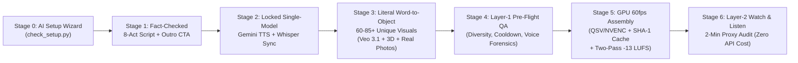

# 🎬 AI Documentary Video-Making Studio Skill (`v4.0 Pro Studio`)

[](https://github.com/gmakercodeby-arch/ai-documentary-video-studio-skill)
[](https://github.com/gmakercodeby-arch/ai-documentary-video-studio-skill)
[](https://github.com/gmakercodeby-arch/ai-documentary-video-studio-skill)
[](LICENSE)

> **Turn your AI Coding Agent (Antigravity, Claude Code, Cursor, Gemini CLI, Codex) into a complete, zero-defect 12–22 minute YouTube AI Documentary Production Studio.**

Designed from forensic reverse-engineering of viral multi-million-view Hindi & English engineering documentaries, **v4.0 Pro Studio** automates the entire pipeline — from grounded research and 8-Act retention scripting to single-model Gemini TTS narration, **literal word-to-object visual matching (`60–85+` unique assets, zero lazy repetition)**, hardware GPU 60fps FFmpeg assembly, and **autonomous 2-Layer "Watch & Listen" QA** — all with **1-Click Install** and an **AI-Guided First-Run Setup Wizard**!

---

## ⚡ 1-Click Install

### Option A — 1-Click AI Agent Install (Easiest! Works in Antigravity, Claude Code, Cursor, Codex, Gemini CLI)
Just paste this single prompt into your AI agent:

```text
Install https://github.com/gmakercodeby-arch/ai-documentary-video-studio-skill as an agent skill and run its interactive setup wizard for me.
```

Your AI agent will automatically install the skill, check your system (`FFmpeg`, `GPU`, `Python`, `Playwright`, `faster-whisper`), and walk you through setting up your channel badge, language, Gemini API key, and optional Outro CTA!

### Option B — Windows 1-Click Command (PowerShell)
```powershell
irm https://raw.githubusercontent.com/gmakercodeby-arch/ai-documentary-video-studio-skill/main/install.ps1 | iex
```

### Option C — macOS / Linux 1-Click Command (Bash)
```bash
curl -fsSL https://raw.githubusercontent.com/gmakercodeby-arch/ai-documentary-video-studio-skill/main/install.sh | bash
```

---

## 🏗️ End-to-End Studio Architecture



---

## 🔥 Why v4.0 Pro Studio? (Battle-Tested Engineering Upgrades)

| Capability | What It Does |
|---|---|
| **🎯 Literal Word-to-Object Visual Grounding** | Mandatory `visual_noun_map.json` audit extracts every concrete object (*NASA satellite, computer 3D CAD map, wind tunnel, underwater tunnel*) and pins its exact visual to the spoken Whisper timestamp! |
| **🚫 Hard Anti-Repetition Enforcement** | `preflight_qa.py` **automatically FAILS** any 10+ min video with `< 55` unique assets, `> 4` uses of any single image/clip, or `< 12` shots cooldown! |
| **🎙️ Single-Model Locked TTS (`Fenrir`)** | Locks ONE TTS model (`gemini-3.1-flash-tts-preview`) across all acts with sentence-boundary chunking (`60–90` words), atomic disk cache, auto-retry on `>2.5s` silence/WPM glitches, and **100% local voice-tone forensics** (RMS dB + ZCR Hz + 350Hz warmth ratio). |
| **⚡ Hardware GPU + SHA-1 Smart Caching** | Auto-detects **Intel QuickSync (`h264_qsv`)** or **NVIDIA (`h264_nvenc`)** (+ `libx264` fallback) with multi-core parallel workers (`--workers 3`). Fixing 1 clip reuses 95%+ unchanged clips in **`0.0s`**! |
| **✨ Pro Glassmorphism Motion Graphics** | Playwright HTML/CSS translucent glassmorphism lower-thirds & bottom-right channel badge pill — zero flat boxy watermarks. |
| **🔊 Broadcast Cinema Audio Mastering** | Batched `0.25s` `xfade` with lossless PCM `.mkv` intermediates (`0.000s` sync drift!), BGM sidechain ducking, and a single true two-pass `loudnorm` (`-13.0 LUFS`, `TP=-1.5`). |
| **👁️👂 2-Layer Autonomous Watch & Listen QA** | Auto-generates lightweight **2-minute** QA proxy MP4s (`480p @ 2fps + 44.1kHz 64k stereo`, `~5 MB` each) so your multimodal AI agent literally watches & listens to the full documentary before delivery — **zero extra API cost!** |

---

## 📁 Repository Structure

```text
ai-documentary-video-studio-skill/
├── SKILL.md                          # Master AI Agent Skill Blueprint (v4.0 + Stage 0 Setup Wizard)
├── README.md                         # Documentation & 1-Click Install Guide
├── install.ps1                       # Windows 1-Click PowerShell Installer
├── install.sh                        # macOS / Linux 1-Click Bash Installer
├── requirements.txt                  # Python dependencies
├── .env.example                      # Safe template for GEMINI_API_KEY (NEVER commit real keys!)
├── studio_config.example.json        # Channel badge, language & optional Outro CTA config
├── LICENSE                           # MIT License
└── scripts/
    ├── check_setup.py                # System, FFmpeg, GPU, Python & Config Doctor (Stage 0)
    ├── generate_voiceover.py         # Locked Gemini TTS generator + silence/WPM sanity auto-retry
    ├── align_narration.py            # Local faster-whisper word-level timestamp aligner
    ├── generate_cutaway_image.py     # 16:9 photorealistic 3D cutaway & object visual generator
    ├── preflight_qa.py               # Layer-1 QA: Asset grids, voice forensics, diversity & reuse gate
    ├── assemble_documentary.py       # GPU + Multi-Core + SHA-1 Cached 1080p@60fps FFmpeg Assembler
    └── make_qa_proxy.py              # Layer-2 QA: 2-min multimodal Watch & Listen proxy builder
```

---

## 🚀 Quick Usage After Install

1. Copy `.env.example` → `.env` and add your `GEMINI_API_KEY` (or let the AI Setup Wizard guide you!).
2. Run the system health check:
   ```bash
   python scripts/check_setup.py
   ```
3. Tell your AI Agent:
   > *"Use `ai-documentary-studio` to create a 14-minute 1080p@60fps Hindi engineering documentary on **[Your Topic]**!"*

---

## 🛡️ Security & Privacy
- **Zero hardcoded API keys or personal paths.**
- `.gitignore` strictly blocks `.env`, audio/video renders, and temporary caches.
- All video processing, Whisper alignment, voice-tone forensics, and Watch & Listen QA proxies run **100% locally** on your machine.

---

## 📄 License
MIT License — free for personal and commercial YouTube & documentary production. Star ⭐ the repo if it helps you ship viral documentaries!
