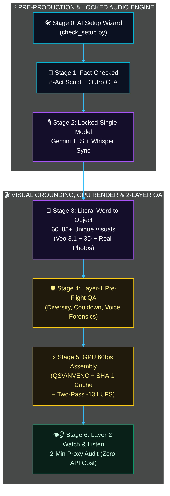

<div align="center">

<!-- Animated Cyber-Neon Header Banner -->


<!-- Animated Neon Typing Tagline -->
<a href="https://github.com/gmakercodeby-arch/ai-documentary-video-studio-skill">
  
</a>

<br/>

<!-- Primary Pro Badges -->
<p align="center">
  <a href="https://github.com/gmakercodeby-arch/ai-documentary-video-studio-skill">
    
  </a>
  <a href="https://github.com/gmakercodeby-arch/ai-documentary-video-studio-skill">
    
  </a>
  <a href="https://github.com/gmakercodeby-arch/ai-documentary-video-studio-skill">
    
  </a>
  <a href="LICENSE">
    
  </a>
</p>

<!-- Live Repo & Tech Stack Badges -->
<p align="center">
  
  
  
  
  
</p>

<br/>

> **Turn your AI Coding Agent (`Antigravity` • `Claude Code` • `Cursor` • `Gemini CLI` • `Codex`) into a complete, zero-defect 12–22 minute YouTube AI Documentary Production Studio.**

<br/>

<!-- Quick Navigation Pills -->
<p align="center">
  <a href="#-1-click-install"><kbd>⚡ 1-Click Install</kbd></a> &nbsp;•&nbsp;
  <a href="#-end-to-end-studio-architecture"><kbd>🏗️ Architecture</kbd></a> &nbsp;•&nbsp;
  <a href="#-why-v40-pro-studio"><kbd>🔥 Pro Upgrades</kbd></a> &nbsp;•&nbsp;
  <a href="#-repository-structure"><kbd>📁 Repo Map</kbd></a> &nbsp;•&nbsp;
  <a href="#-quick-usage-after-install"><kbd>🚀 Quick Start</kbd></a>
</p>

</div>

<!-- Neon Gradient Divider -->


<br/>

Designed from forensic reverse-engineering of viral multi-million-view Hindi & English business and engineering documentaries, **`v5.3 Bulletproof Zero-Defect Cinema Engine`** automates the entire production pipeline — from grounded research and 8-Act retention scripting to locked single-model Gemini TTS narration (with automated spoken stage-direction hallucination detection), **sentence-exact visual sync + 5-frame sub-beat scrubbing**, **automated video-clip EOF bounds checking & auto-clamp shielding (`0.000s` drift, zero black screens)**, static-slide blocking, smart `360p/720p` credit-saving video generation, hardware GPU 60fps FFmpeg assembly, and an **autonomous 100% Full-Video "Watch & Listen" + Black-Frame Proxy Detector + Auto-Fix QA Loop** — all with **1-Click Install** and an **AI-Guided First-Run Setup Wizard**.

<!-- Studio Spec Highlights Strip -->
<div align="center">

| 🎞️ Output Master | 🎨 Asset Diversity | 🔊 Broadcast Audio | ⚡ Render Speed | 👁️👂 Autonomous QA |
| :---: | :---: | :---: | :---: | :---: |
| **`1080p @ 60fps`**<br/>Cinema Grade | **`60–85+` Unique**<br/>Zero Lazy Loops | **`-13.0 LUFS`**<br/>Two-Pass + Ducking | **`QSV / NVENC`**<br/>SHA-1 `0.0s` Reuse | **`2-Min Proxies`**<br/>Zero Extra API Cost |

</div>

<br/>


## ⚡ 1-Click Install

> [!TIP]
> **Easiest Method (Recommended):** Use **Option A** inside Antigravity, Claude Code, Cursor, Codex, or Gemini CLI. Your AI agent installs everything, verifies `FFmpeg`, `GPU`, `Python`, `Playwright`, and `faster-whisper`, and configures your channel badge, language, Gemini API key, and optional Outro CTA automatically.

### 🤖 Option A — 1-Click AI Agent Install
Paste this single prompt into your AI agent:

```text
Install [https://github.com/gmakercodeby-arch/ai-documentary-video-studio-skill](https://github.com/gmakercodeby-arch/ai-documentary-video-studio-skill) as an agent skill and run its interactive setup wizard for me.
```

<details>
<summary><b>🪟 Option B — Windows 1-Click Command (PowerShell)</b></summary>
<br/>

```powershell
irm [https://raw.githubusercontent.com/gmakercodeby-arch/ai-documentary-video-studio-skill/main/install.ps1](https://raw.githubusercontent.com/gmakercodeby-arch/ai-documentary-video-studio-skill/main/install.ps1) | iex
```

</details>

<details>
<summary><b>🐧 Option C — macOS / Linux 1-Click Command (Bash)</b></summary>
<br/>

```bash
curl -fsSL [https://raw.githubusercontent.com/gmakercodeby-arch/ai-documentary-video-studio-skill/main/install.sh](https://raw.githubusercontent.com/gmakercodeby-arch/ai-documentary-video-studio-skill/main/install.sh) | bash
```

</details>

<br/>


## 🏗️ End-to-End Studio Architecture



<br/>


## 🔥 Why v4.0 Pro Studio?

<table>
  <tr>
    <td width="50%" valign="top">
      <h3>🎯 Literal Word-to-Object Grounding</h3>
      Mandatory <code>visual_noun_map.json</code> audit extracts every concrete object (<i>NASA satellite, 3D CAD map, wind tunnel, underwater tunnel</i>) and pins its exact visual to the spoken Whisper timestamp.
    </td>
    <td width="50%" valign="top">
      <h3>🚫 Hard Anti-Repetition Gate</h3>
      <code>preflight_qa.py</code> <b>automatically FAILS</b> any 10+ min documentary with <code>&lt; 55</code> unique assets, <code>&gt; 4</code> uses of any single photo/clip, or <code>&lt; 12</code> shots cooldown.
    </td>
  </tr>
  <tr>
    <td width="50%" valign="top">
      <h3>🎙️ Locked Single-Model TTS (<code>Fenrir</code>)</h3>
      Locks ONE model (<code>gemini-3.1-flash-tts-preview</code>) across all acts with <code>60–90</code> word sentence chunking, atomic disk cache, auto-retry on <code>&gt;2.5s</code> silence/WPM drops, and <b>100% local voice-tone forensics</b> (RMS dB + ZCR Hz + 350Hz warmth ratio).
    </td>
    <td width="50%" valign="top">
      <h3>⚡ Hardware GPU + SHA-1 Smart Cache</h3>
      Auto-detects <b>Intel QuickSync (<code>h264_qsv</code>)</b> or <b>NVIDIA (<code>h264_nvenc</code>)</b> (+ <code>libx264</code> fallback) with multi-core parallel workers (<code>--workers 3</code>). Fixing 1 clip reuses 95%+ unchanged clips in <b><code>0.0s</code></b>.
    </td>
  </tr>
  <tr>
    <td width="50%" valign="top">
      <h3>✨ Glassmorphism Motion Graphics</h3>
      Playwright HTML/CSS translucent glassmorphism lower-third callout cards & sleek bottom-right channel badge pill — zero flat boxy watermarks.
    </td>
    <td width="50%" valign="top">
      <h3>🔊 Broadcast Cinema Mastering</h3>
      Batched <code>0.25s</code> <code>xfade</code> with lossless PCM <code>.mkv</code> intermediates (<code>0.000s</code> sync drift), BGM sidechain auto-ducking, and a single true two-pass <code>loudnorm</code> (<code>-13.0 LUFS</code>, <code>TP=-1.5</code>).
    </td>
  </tr>
  <tr>
    <td colspan="2" valign="top">
      <h3>👁️👂 2-Layer Autonomous Watch & Listen QA</h3>
      Auto-generates lightweight <b>2-minute</b> QA proxy MP4s (<code>480p @ 2fps + 44.1kHz 64k stereo</code>, <code>~5 MB</code> each) so your multimodal AI agent literally watches & listens to the full documentary before delivery — <b>zero extra API cost!</b>
    </td>
  </tr>
</table>

<br/>


## 📁 Repository Structure

<details open>
<summary><b>📂 Click to expand / collapse full Studio Blueprint</b></summary>

```text
ai-documentary-video-studio-skill/
├── SKILL.md                          # Master AI Agent Skill Blueprint (v4.0 + Stage 0 Setup Wizard)
├── README.md                         # High-Graphics Documentation & 1-Click Install Guide
├── install.ps1                       # Windows 1-Click PowerShell Installer
├── install.sh                        # macOS / Linux 1-Click Bash Installer
├── requirements.txt                  # Python dependencies
├── .env.example                      # Safe template for GEMINI_API_KEY (NEVER commit real keys!)
├── studio_config.example.json        # Channel badge, language & optional Outro CTA config
├── LICENSE                           # MIT License
└── scripts/
    ├── check_setup.py                # System, FFmpeg, GPU, Python & Config Doctor (Stage 0)
    ├── generate_voiceover.py         # Locked Gemini TTS generator + silence/WPM sanity auto-retry
    ├── align_narration.py            # Local faster-whisper word-level timestamp aligner
    ├── generate_cutaway_image.py     # 16:9 photorealistic 3D cutaway & object visual generator
    ├── preflight_qa.py               # Layer-1 QA: Asset grids, voice forensics, diversity & reuse gate
    ├── assemble_documentary.py       # GPU + Multi-Core + SHA-1 Cached 1080p@60fps FFmpeg Assembler
    └── make_qa_proxy.py              # Layer-2 QA: 2-min multimodal Watch & Listen proxy builder
└── skills/
    └── gmz-viral-topic-hunter/       # Companion Skill: 32-Channel yt-dlp Engineering + Business Case-Study Hunter
        ├── SKILL.md
        ├── hooks_and_niches.json
        └── scripts/hunt_viral_topics.py
```

</details>

<br/>


## 🚀 Quick Usage After Install

<table>
  <tr>
    <td align="center" width="8%"><b>1️⃣</b></td>
    <td>Copy <code>.env.example</code> → <code>.env</code> and add your <code>GEMINI_API_KEY</code> (or let the AI Setup Wizard guide you).</td>
  </tr>
  <tr>
    <td align="center"><b>2️⃣</b></td>
    <td>Run the system & GPU health doctor:
      <pre><code>python scripts/check_setup.py</code></pre>
    </td>
  </tr>
  <tr>
    <td align="center"><b>3️⃣</b></td>
    <td>Command your AI Agent:
      <blockquote><i>"Use <code>ai-documentary-studio</code> to create a 14-minute 1080p@60fps Hindi engineering documentary on <b>[Your Topic]</b>!"</i></blockquote>
    </td>
  </tr>
</table>

<br/>

## 🛡️ Security & Privacy

> [!IMPORTANT]
> - **Zero hardcoded API keys or personal paths** anywhere in the repository.
> - `.gitignore` strictly blocks `.env`, audio/video renders, and temporary caches.
> - All video processing, Whisper alignment, voice-tone forensics, and Watch & Listen QA proxies run **100% locally** on your machine.

<br/>

## 📄 License

Licensed under the **[MIT License](LICENSE)** — free for personal and commercial YouTube & documentary production.

<div align="center">
  <br/>
  <a href="https://github.com/gmakercodeby-arch/ai-documentary-video-studio-skill/stargazers">
    
  </a>
  <br/><br/>
  <!-- Animated Cyber-Neon Footer Wave -->
  
</div>
